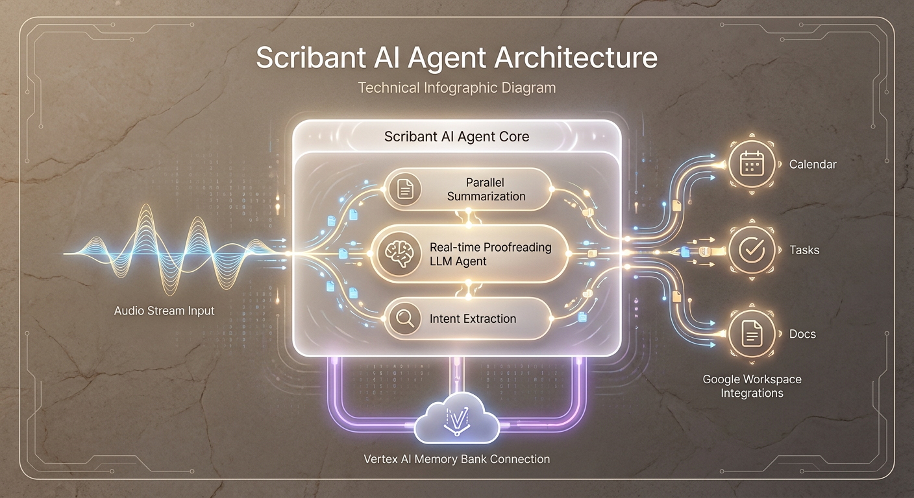
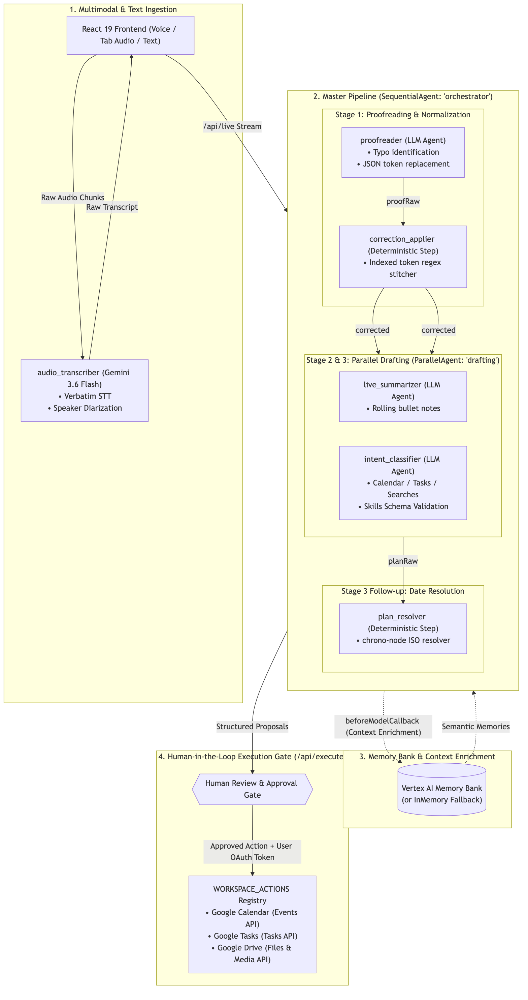
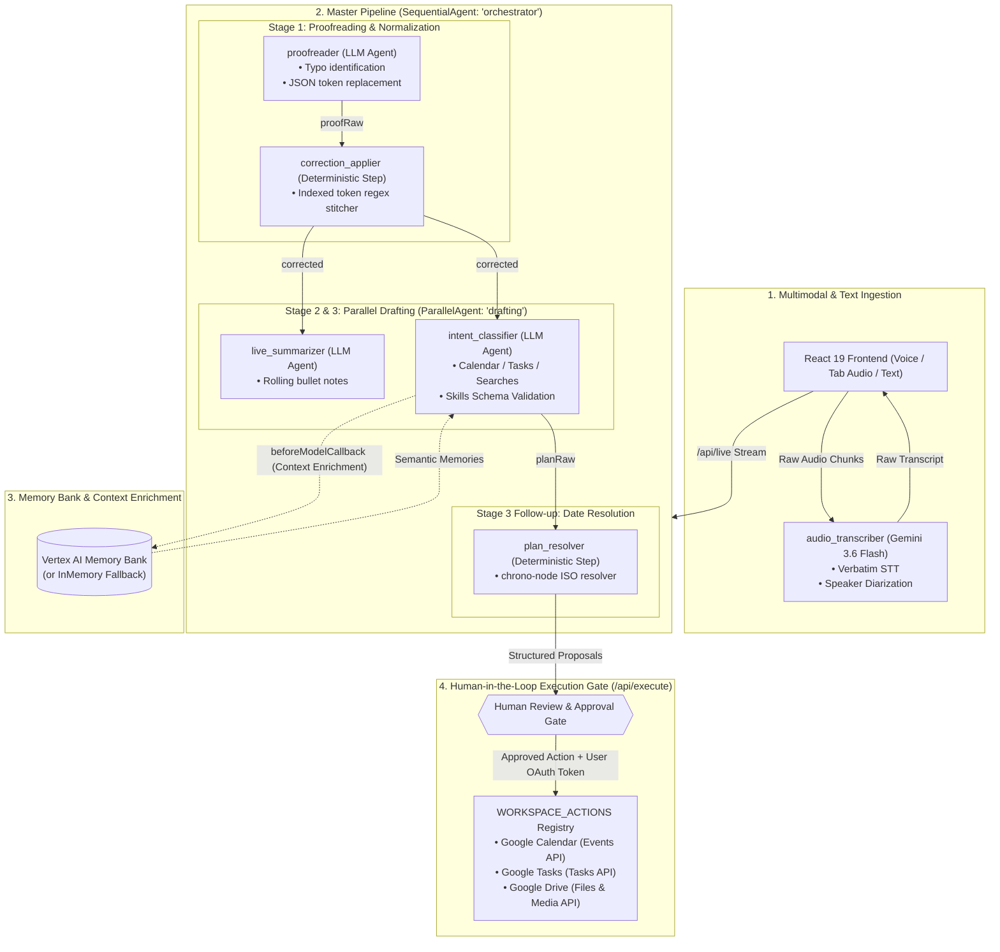
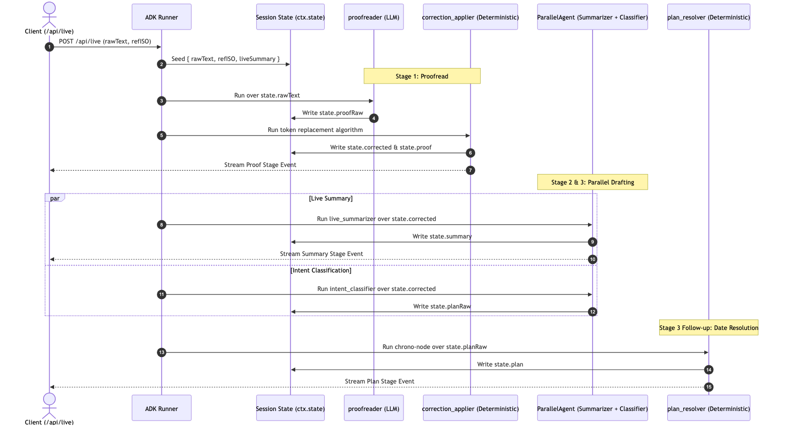
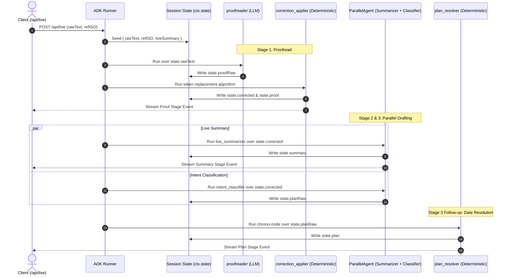
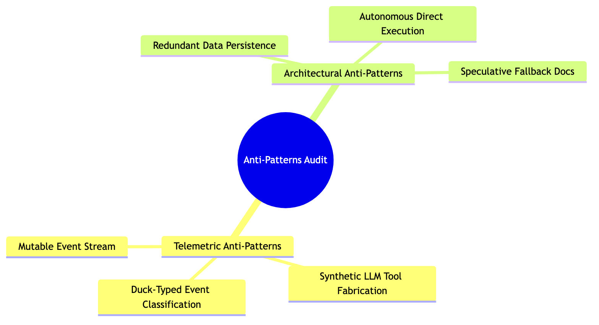
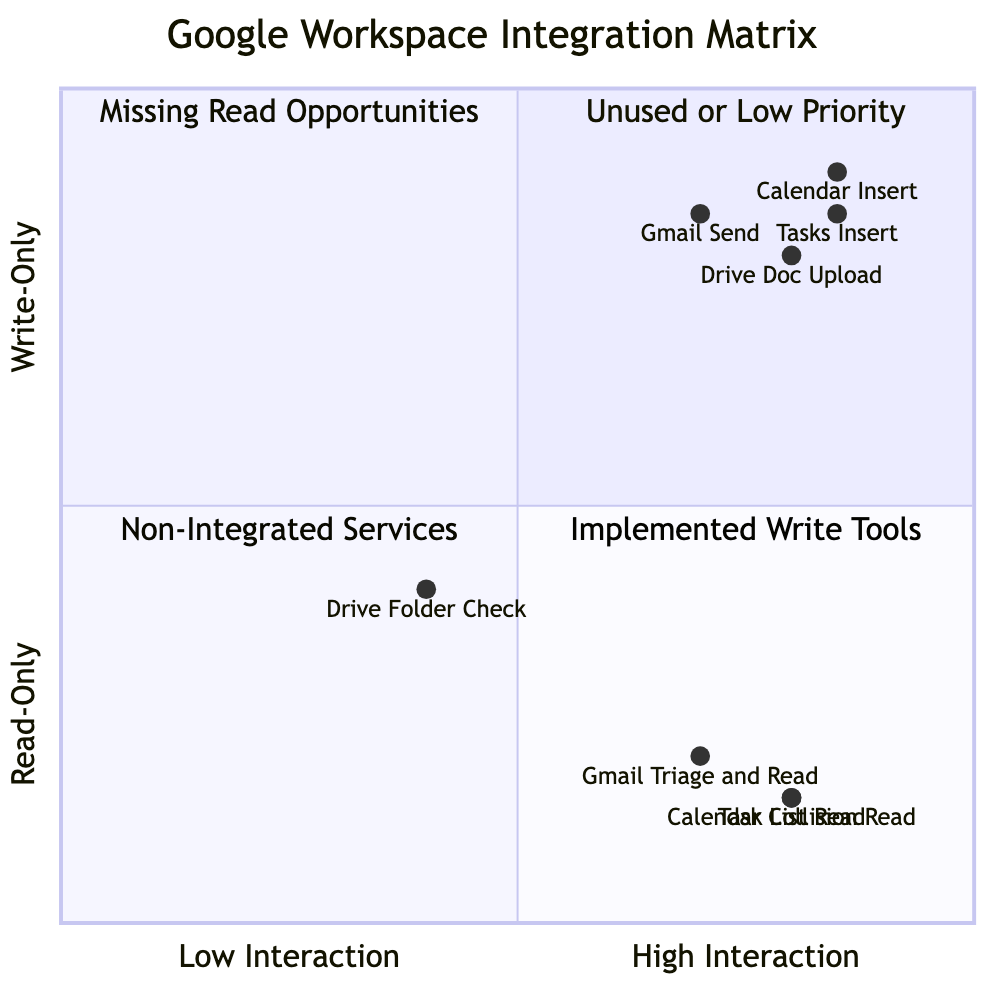
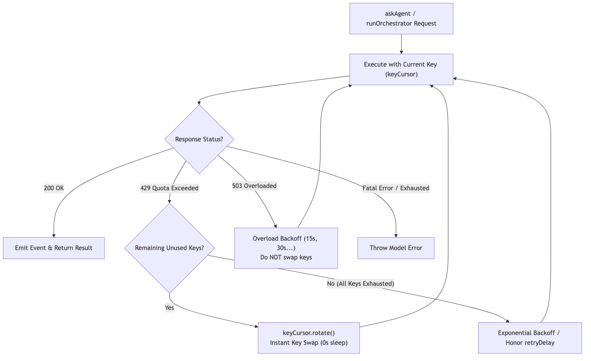
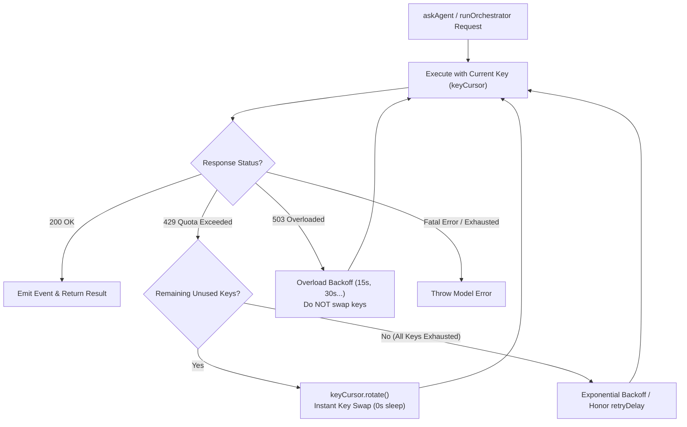

# Scribant Agent: Architectural Analysis & Anti-Patterns Review



## Executive Summary

**Scribant** is an intelligent thought-partner agent engineered to ingest raw, unfiltered streams of spoken thoughts, transcribe and proofread them in real time, extract structured intents (Google Calendar events, Google Tasks, grounded search queries, Drive session notes), and continuously enrich its understanding using Vertex AI Memory Bank.

This document provides a comprehensive technical overview of Scribant's architecture, evaluates its agent topology, and details the critical **agentic anti-patterns** identified and resolved in the codebase to align with **Google's Agent Development Kit (`@google/adk`)** standards.

---

## 1. System Topology & Agent Hierarchy

Scribant decouples real-time reasoning into a specialized multi-agent pipeline orchestrated by `@google/adk`.



<details>
<summary>View Mermaid Source</summary>


</details>

---

## 2. Comprehensive Agent & Component Inventory

| Component | Architecture Type | Model / Runtime | Input State | Output State | Operational Role |
| :--- | :--- | :--- | :--- | :--- | :--- |
| **`orchestrator`** | `SequentialAgent` | ADK Runner | `rawText`, `refISO`, `liveSummary` | `OrchestratorResult` | Root pipeline coordinator. Manages stage execution (`proof` $\to$ `summary` / `plan`), dynamic retries, and NDJSON streaming. |
| **`proofreader`** | `LlmAgent` | `Gemini 3.6 Flash` | `state.rawText` | `state.proofRaw` | Analyzes raw speech for phonetic typos and mishearings. Returns structured token replacement indices. |
| **`correction_applier`** | `Step` (`BaseAgent`) | Deterministic TS | `state.proofRaw`, `state.rawText` | `state.corrected`, `state.proof` | Pure function that applies replacement indices to generate clean text without hallucinating alterations. |
| **`live_summarizer`** | `LlmAgent` | `Gemini 3.6 Flash` | `state.corrected` | `state.summary` | Synthesizes a rolling Markdown bullet-point summary of key ideas while speech is active. |
| **`intent_classifier`** | `LlmAgent` | `Gemini 3.6 Flash` + Zod Schema | `state.corrected`, `state.liveSummary`, `state.refISO` | `state.planRaw` | Extracts action items (`calendarEvents`, `tasks`, `searchQueries`). Enriched by `memoryBankBeforeModelCallback`. |
| **`plan_resolver`** | `Step` (`BaseAgent`) | Deterministic TS (`chrono-node`) | `state.planRaw`, `state.refISO` | `state.plan` | Normalizes ambiguous relative date/time strings ("tomorrow morning", "next Friday") into exact ISO timestamps. |
| **`audio_transcriber`** | `LlmAgent` | `Gemini 3.6 Flash` (Multimodal) | Audio `inlineData` parts | Text Transcript | Transcribes audio chunks and attributes dialogue to distinct speakers ("Alice", "Bob", "You"). |
| **`grounded_searcher`** | `LlmAgent` | `Gemini 3.6 Flash` + `GOOGLE_SEARCH` | User query via `/api/search` | Grounded summary + citations | Standalone research agent using native ADK Google Search grounding. |
| **`memory_answerer`** | `LlmAgent` | `Gemini 3.6 Flash` | User query + retrieved memories | Direct answer | Synthesizes answers to questions regarding past sessions from Vertex AI Memory Bank chunks. |

---

## 3. Session State Passing vs. User Message Passing

A core design strength of Scribant is its use of **ADK Session State** rather than concatenating user messages across LLM turns:



<details>
<summary>View Mermaid Source</summary>


</details>

### Why This Matters:
1. **Token Efficiency**: LLMs only receive the exact text field they need (`corrected` text), preventing token blowup from prior prompt instructions leaking into downstream stages.
2. **Deterministic Interleaving**: Pure TypeScript logic (`Step`) can inspect intermediate model output, normalize data, and write clean state for subsequent agents.
3. **Independent Stage Retries**: If `intent_classifier` fails on a 429 rate limit, the runner retries only that stage using already-cached `corrected` state without re-running the proofreader.

---

## 4. Analysis of Anti-Patterns Identified & Remediated

During the architectural audit, several subtle anti-patterns were uncovered in the codebase. Below is an in-depth analysis of each issue, why it degraded system reliability, and how it was surgically resolved.



---

### Anti-Pattern 1: In-Place Mutation of the ADK Event Stream

#### The Problem:
In `adk-events.ts`, `AdkEventStream` provided an `updateLatest(id, patch)` method that modified existing `Event` objects in-memory after they had already been emitted to subscribers.

#### Why This Is an Anti-Pattern:
- **Violation of Event Sourcing & Immutability**: ADK events are strictly immutable, point-in-time facts. Mutating events in-place creates race conditions in Server-Sent Events (SSE) and corrupts downstream telemetry consumers.
- **Lost History**: If an agent changes its state or generates a follow-up answer, rewriting the previous event destroys the audit trail of what occurred at that specific millisecond.

#### The Remediation:
1. Removed `updateLatest()` completely from `adk-events.ts`.
2. Converted subsequent operations (e.g., memory query response synthesis) to emit a distinct, follow-up immutable `Event` (`author: "memory"`, `eventType: "memory:retrieve"`).

```diff
- // ANTI-PATTERN: Mutating previously emitted events in place
- memoryEvents.updateLatest(eventId, {
-   content: { parts: [{ text: synthesizedAnswer }] }
- });

+ // ADK BEST PRACTICE: Append-only immutable follow-up event
+ emitAdkEvent(createEvent({
+   author: "memory",
+   content: { role: "model", parts: [{ text: synthesizedAnswer }] },
+   customMetadata: { eventType: "memory:retrieve", query, count: memories.length }
+ }));
```

---

### Anti-Pattern 2: Synthetic LLM Tool-Call Fabrication

#### The Problem:
In `server.ts`, endpoints that executed non-LLM operations (like ambient search lookups or memory queries) manually constructed mock `Event` objects mimicking `functionCall` and `functionResponse` parts to make them look like ADK tool executions.

#### Why This Is an Anti-Pattern:
- **Distorted Telemetry & Tracing**: LLM evaluation harnesses, tracing agents, and Cloud Trace monitor tool trajectories to calculate model tool accuracy. Fabricating synthetic tool events fools observability dashboards into recording model tool calls that the model never made.
- **Brittle Schema Coupling**: Mocking internal ADK protobuf/JSON structures requires maintaining private schema shapes that break across ADK SDK updates.

#### The Remediation:
1. Removed all artificial `functionCall` / `functionResponse` mocking wrappers from ambient HTTP routes.
2. For true tool-calling agents (`grounded_searcher`), configured native ADK tool definitions (`tools: [GOOGLE_SEARCH]`) and let the ADK `Runner` emit genuine tool telemetry.

---

### Anti-Pattern 3: Non-Standard Heuristic Event Classification

#### The Problem:
`classifyAdkEventType()` in `adk-events.ts` relied on complex string matching and duck-typing across arbitrary JSON properties (`if (p.functionCall) return "tool_call"`, `if (ev.customMetadata) ...`) instead of utilizing ADK's native event classification helpers.

#### Why This Is an Anti-Pattern:
- Custom duck-typing frequently misclassifies valid multi-part events (e.g., multimodal audio parts or structured JSON responses).
- As ADK evolves its event schema, home-grown parsers silently drift or produce `"unknown"` event classifications.

#### The Remediation:
Refactored `classifyAdkEventType()` in `adk-events.ts` to inspect standard ADK `toStructuredEvents(event)` and explicit event attributes:

```ts
export function classifyAdkEventType(event: Event): AdkEventType {
  // 1. ADK native structured event inspection
  const structured = toStructuredEvents(event);
  if (structured.some(s => s.type === "model_call")) return "llm:call";
  if (structured.some(s => s.type === "tool_call")) return "tool:call";
  if (structured.some(s => s.type === "tool_result")) return "tool:result";

  // 2. Deterministic step actions & session delta
  if (event.actions?.stateDelta) return "state:update";

  // 3. Explicit agent authoring
  if (event.author === "system") return "system:log";
  if (event.author === "memory") return "memory:retrieve";
  return "agent:turn";
}
```

---

### Anti-Pattern 4: Redundant Data Storage & Double Persistence

#### The Problem:
The application maintained a legacy `data/transcripts/` directory where raw session text was flushed on every debounce tick, in addition to writing full ADK event streams to `data/events/{YYYY}/{MM}/{DD}/{HH}/events.jsonl`.

#### Why This Is an Anti-Pattern:
- **Data Duplication & Synchronization Drift**: Storing state in two uncoordinated locations risks divergent state (e.g., event logs showing a rolled-back turn that still exists in flat transcript files).
- **Disk I/O Contention**: Writing flat files on every rapid keystroke/speech debounce tick creates unnecessary file I/O overhead.

#### The Remediation:
1. Deleted the `data/transcripts/` directory and removed legacy transcript flush utilities from `server-utils.ts`.
2. Standardized on the single source of truth: the time-partitioned **ADK Event Log** (`data/events/`).

---

### Anti-Pattern 5: Speculative / Phantom Fallback Documentation

#### The Problem:
`GEMINI.md` listed `OLLAMA_MODEL=gemma3` as a supported local fallback mechanism. However, an exhaustive code search revealed that Ollama had never been integrated—all agent factories strictly instantiated `Gemini`.

#### Why This Is an Anti-Pattern:
- **Misleading Operational Assumptions**: Developers or collaborating agents would assume offline resilience was active when, in reality, requests would fail.
- **Speculative Drift**: Documenting planned or imagined features rather than what the code actually implements damages documentation integrity.

#### The Remediation:
1. Purged all fictional Ollama references from `GEMINI.md`.
2. Accurately documented the **actual** dual resilience strategies:
   - **Multi-Key API Rotation Engine**: 5-key automatic load-balancing and backoff on HTTP 429s.
   - **Vertex AI Enterprise Mode**: Zero-key authentication via Google Cloud ADC / IAM (`GOOGLE_GENAI_USE_VERTEXAI=true`).

---

### Anti-Pattern 6: Autonomous Direct Execution vs. Human Approval Gate

#### Architectural Analysis:
A common temptation in agent engineering is giving the LLM immediate autonomous execution tools (e.g., an LLM directly calling `insertCalendarEvent()` or `createTask()` mid-stream).

#### Why Scribant Avoids This Anti-Pattern:
- **Speech Ambiguity**: Spoken thoughts are messy and non-linear. If a user says *"Let's meet tomorrow at 3... actually wait, Friday is better"*, an autonomous agent would create a spurious event and then struggle to cancel it.
- **The Scribant Model (Extraction $\to$ Review $\to$ Execution)**:
  1. `intent_classifier` extracts structured proposals with confidence indicators (`uncertain: boolean`, `explicitCommand: boolean`).
  2. The UI renders high-visibility review cards.
  3. The user clicks to approve or edit the proposal.
  4. `/api/execute` executes the action against `WORKSPACE_ACTIONS` in `workspace-tools.ts` with the user's OAuth token.

---

## 5. Google Workspace Integration & CLI (`gws`) Status

### Current Capability Matrix



### 1. Implemented Write Tools (`workspace-tools.ts`)
- **`create_calendar_event`**: Supports all-day and timed events, timezones, and descriptions. Includes delete/undo.
- **`create_task`**: Supports titles, notes, due dates, and deletion/undo.
- **`create_drive_folder` & `create_drive_doc`**: Idempotent folder lookups and Markdown report uploads.

### 2. Available Tooling: Google Workspace CLI (`gws 0.22.5`)
- Installed at `/Users/luissala/.nvm/versions/node/v22.19.0/bin/gws`.
- Authenticated with OAuth2 under `luissala@laxmih.altostrat.com` with active scopes for Drive, Docs, Calendar, Tasks, and Cloud Platform.

---

## 6. Resilience & Production Load-Balancing Engine

To prevent free-tier API exhaustion and transient overload (503s), `agents.ts` implements an intelligent key rotation runner:



<details>
<summary>View Mermaid Source</summary>


</details>

### Key Properties:
- **Instant Swaps on Quota**: If Key 1 hits a 429, the runner immediately rotates to Key 2 with **0 seconds delay**.
- **Overload Awareness (503)**: Since 503 is a backend model overload, swapping keys does not help. The runner backs off immediately rather than burning through other keys.
- **Sticky Cursors**: Once rotation discovers a healthy key, subsequent requests start on that key rather than repeating the failure cycle on exhausted keys.

---

## 7. Developer Playbook & LLM-Friendly `Makefile`

To ensure agents and engineers can discover and execute workflows reliably, the project provides a self-documenting `Makefile`:

```bash
$ make help
==================================================================================
                      SCRIBANT AGENT DEVELOPMENT WORKFLOWS
==================================================================================

Application Development:
  make dev          Start local dev server with hot reload (Express + Vite) on port 3000.
  make check        MANDATORY VALIDATION GATE. Runs typechecker (tsc --noEmit) and all
                    12 submodule self-test suites. Run this before committing any changes.
  make build        Build production client bundle (dist/) and bundle server.ts via esbuild.
  make start        Run compiled production server from dist/server.cjs.
  make lint         Run fast TypeScript typecheck without emitting files.
  make eval         Run LLM-as-a-judge evaluation benchmark suite against evals/data/.
  make clean        Delete dist/ build directory and compiled artifacts.

Environment & Vertex AI Memory Bank:
  make setup        One-shot end-to-end setup (tf-apply -> setup:env -> check).
  make memory-bank  Manage Vertex AI Memory Bank in GCP. Options:
                      make memory-bank CMD=list
                      make memory-bank CMD=create NAME=<custom-name>
  make env          Regenerate/update .env file from live GCP/Terraform outputs.

Terraform GCP Infrastructure:
  make tf-init      Initialize Terraform providers and local backend.
  make tf-validate  Validate Terraform syntax and configuration.
  make tf-plan      Generate and display GCP infrastructure execution plan.
  make tf-apply     Apply Terraform changes to provision GCP resources.
  make tf-import    Import existing GCP project into state:
                      make tf-import PROJECT_ID=<gcp-project-id>
  make tf-output    Display structured output variables from Terraform state.
  make tf-destroy   Tear down and destroy Terraform-managed GCP infrastructure.
==================================================================================
```

---

## 8. Summary & Strategic Recommendations

1. **Read Tool Expansion**:
   - Equip the agent with read-only tools (`list_calendar_events`, `list_tasks`) to enable real-time conflict detection (e.g., *"You already have a 3 PM sync with Design"*).
2. **Standardized Context Enrichment**:
   - Continue leveraging `memoryBankBeforeModelCallback` to query relevant past session memories before LLM inference, ensuring persistent context without prompt bloat.
3. **Preserve Immutability & Human Gates**:
   - Maintain strict append-only ADK event telemetry and retain the human approval gate for all external state mutations.
